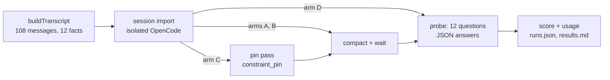

# Recall experiment

Prototype 2 of the context work: a small, bounded harness that asks whether facts from early in a coding session
survive OpenCode's compaction, and whether lookup tools or pinned constraints help. It compares four arms on the same
synthetic transcripts with one model.

| Arm | Setup |
| --- | --- |
| A | OpenCode's native compaction (manual, `keep.tokens` from `--keep-tokens`) |
| B | A, plus the [opencode-history](https://github.com/StevenJPx2/opencode-history) plugin's `history_search` tool |
| C | B, plus [`packages/pinned-constraints`](../../packages/pinned-constraints), with one pin pass before compaction |
| D | Oracle: no compaction, the whole transcript in context (skipped if it would not fit 80% of the context window) |

Latest results: [`results/results.md`](results/results.md). Raw answers and scores: [`results/runs.json`](results/runs.json).

## Run it

```sh
bun experiments/recall/run.ts --history-plugin ~/Documents/Projects/opencode-history
bun experiments/recall/run.ts --transcripts 1 --arms A,D     # quick check, no plugins needed
bun experiments/recall/run.ts --help
```

| Option | Default | Meaning |
| --- | --- | --- |
| `--model` | `opencode/hy4-flash-free` | One model for every arm, as `provider/model` |
| `--arms` | `A,B,C,D` | Arms to run |
| `--transcripts` | `5` | 1 to 5 transcripts |
| `--seed` | `1` | Transcript and probe seed |
| `--keep-tokens` | `4000` | Compaction `keep.tokens` |
| `--turn-timeout` | `300` | Seconds one model turn may take |
| `--history-plugin` | none | opencode-history checkout or staged release; arms B and C are skipped without it |
| `--pinned-plugin` | `packages/pinned-constraints` | pinned-constraints package for arm C |
| `--out` | `experiments/recall/results` | Where `results.md` and `runs.json` are written after every run |

A full run is 20 runs (5 transcripts × 4 arms) and takes roughly 20 to 30 minutes with the default free model.

Requirements: `opencode` on `PATH`, `git`, Bun, and an active credential for the model's provider in your OpenCode
store (`opencode auth list`). No dependency is added to the plugin packages.

## How a run works



1. A fresh isolated OpenCode starts (see Isolation), with the arm's plugins.
2. The transcript is imported as an existing session (`POST /api/experimental/session/import`), so no model call is spent
   replaying it.
3. Arm C first asks the agent to pin every rule and value still in force.
4. Arms A to C request compaction (`POST /api/session/:id/compact`) and wait for it.
5. The probe asks one question per planted fact and wants a JSON object back. The same probe text is used in every arm;
   it invites the model to use lookup tools when unsure.
6. The run's messages are read back: answers are scored, tool calls counted, and token usage summed over every message
   the run added (pin pass, compaction summary, probe). Then the instance is stopped and its scratch root deleted.

### Transcripts

Five deterministic transcripts (seeded PRNG), one per scenario: invoice service, sync CLI, search indexer, mobile
gateway, notification worker. Each has 108 messages, about 25,000 tokens, of ordinary coding requests and replies with
code and test output. About a third of requests also change an unprobed setting in passing, so the planted facts
compete for room in the summary.

Four kinds of fact are planted in three groups, at ages (messages before the probe) of about 10, 50 and 100:

| Kind | Said as | Probe | Correct when |
| --- | --- | --- | --- |
| Exact string | "the Sentry project slug is `sentry-u4jn4k`" | its exact value | the generated string appears verbatim |
| Constraint | "going forward: never use axios or raw fetch; …" | one line of code for a task the rule governs | every required pattern matches and no banned one does |
| Correction | a value, then 8 messages later "make it N instead" | the current value | the new number appears |
| Rejected approach | "we tried Jest … don't bring it back; we're going with Vitest" | which approach to use | the accepted approach is named |

Each fact rides at the end of an ordinary request rather than in a message of its own. Pools live in
[`pools.ts`](pools.ts); no two transcripts share an entry.

### Metrics

| Column | Meaning |
| --- | --- |
| Exact-string recall | exact strings answered verbatim |
| Constraint adherence | code lines that follow the rule |
| Correction, Rejected approach | current value given; accepted approach named |
| Stale overrides | answers giving a corrected value's old number, or a rejected approach without the accepted one |
| Lookups | tool calls while answering the probe, by tool |
| Tokens, Cost | input + output + reasoning over all model calls of the run; cache reads shown separately |
| Wall | from the first model request of the run to the probe answer |
| Verbatim from age | from compaction's `keepID`: the oldest message kept word for word |

## Isolation and safety

- Every run gets its own scratch root under `$TMPDIR/opencode/recall-*` with its own `HOME`, `XDG_CONFIG_HOME`,
  `XDG_DATA_HOME`, `XDG_STATE_HOME` and `XDG_CACHE_HOME`. Your OpenCode config, database, `~/.claude` and
  `~/.agents` instructions and skills are never read or written, apart from exporting one credential.
- Each run starts its own background service on a free loopback port through `opencode service` with the isolated
  environment, checks that `opencode debug paths db` points inside the scratch root, and stops that service with
  `opencode service stop` before deleting the root. The harness sends no signals to any process.
- The model's credential is exported once from your store and imported into each isolated instance. An OAuth
  credential is copied without its refresh token, so an isolated instance can never rotate your token; runs fail
  instead if it expires (the harness refuses one that expires within two hours). The secret is never printed or
  written outside the scratch database.
- `OPENCODE_*` and `TYPESAFE_*` variables are dropped, so the history plugin's per-turn recall judge stays off and
  only its `history_search` tool is measured.
- Shell, edit, web, subagent, question, skill, image and Code Mode tools are denied in the isolated config, so a probe
  cannot change files or reach the network, and plugin tools are counted under their own names.
- Every API call has a timeout (`--turn-timeout`; 60 s for setup commands); a timed-out turn is interrupted. The
  experiment stops after three consecutive failed runs. Ctrl-C finishes the current step and cleans up.

## Caveats

- **Small N.** At most 5 runs per arm and 3 facts per kind and age, one model, one sample each. Nothing is
  statistically significant; treat the table as a smoke test of the arms.
- **Synthetic and short.** About 25,000 tokens and 12 facts is far less than a real long session, and the facts are
  cleaner than real ones. A summarizer that keeps everything here may not in a 200,000-token session.
- **`history_search` excludes the current session.** opencode-history searches other sessions (and `session` filters
  never include the caller's), so in arm B it cannot reach the pre-compaction part of the same session. Arm B measures
  what the tool adds in that situation, which is expected to be nothing beyond A.
- Free models have usage limits; a run that hits one is recorded as an error with the provider's message.

## Files

| File | Responsibility |
| --- | --- |
| [`run.ts`](run.ts) | CLI: options, the loop over transcripts and arms, writing `results/` |
| [`arms.ts`](arms.ts) | The four arms, one run end to end, reading messages back into a `RunRecord` |
| [`opencode.ts`](opencode.ts) | `Instance`: an isolated OpenCode with its own service; credential export |
| [`transcripts.ts`](transcripts.ts) | Seeded transcript and probe generation |
| [`pools.ts`](pools.ts) | Planted fact and distractor pools |
| [`score.ts`](score.ts) | Answer parsing and per-fact scoring |
| [`report.ts`](report.ts) | Aggregation into `results.md` |
| [`recall.test.ts`](recall.test.ts) | Generator, scoring, summarizing and credential tests (`bun test experiments`) |

```ts
import { buildProbe, buildTranscript } from "./transcripts.ts"
import { scoreItem } from "./score.ts"

const transcript = buildTranscript(0, 1)
const probe = buildProbe(transcript, 1)
const fact = transcript.planted[0]!.item
scoreItem(fact, "some answer") // { correct, stale, violation }
```
