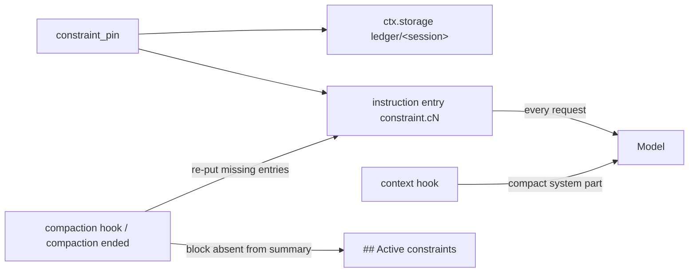

# pinned-constraints

Prototype. Lets the agent pin a constraint the user stated, with the user's exact words, so it reaches the model word
for word on every request and survives compaction. Nothing is extracted by a model: a pin exists only when the agent
calls `constraint_pin`, and the quote must appear verbatim in a user message.



## Modules

| File | Responsibility |
| --- | --- |
| `src/pins.ts` | The pin model and pure ledger operations: input validation, verbatim source check, pin and release, rendering. |
| `src/constraints.ts` | `Constraints`: tools, hooks and the compaction follow-up against the plugin context. |
| `src/index.ts` | `Plugin.define` wiring. |

## Tools

| Tool | Input | Effect |
| --- | --- | --- |
| `constraint_pin` | `text`, `quote`, optional `source` message ID | Adds pin `cN` and puts instruction entry `constraint.cN`. Without `source`, the newest user message containing the quote is used. |
| `constraint_list` | none | Lists active and released pins. |
| `constraint_release` | `id`, `reason` | Marks the pin overridden and removes its entry; the ledger keeps it. |

```ts
await tools.constraint_pin({ text: "Do not touch the prod database.", quote: "never touch the prod database" })
// "Pinned c1: Do not touch the prod database."
```

The entry renders in the session's instructions as:

```text
<context key="constraint.c1">
Pinned constraint c1: Do not touch the prod database.
Verbatim from message msg_…:
never touch the prod database
</context>
```

## Compaction

- The `context` and `compaction` hooks reconcile entries with the ledger: missing or altered pins are put again,
  entries of released pins are removed. Other entries are left alone.
- When an earlier hook supplied the summary, the `## Active constraints` block is appended to it if absent.
- A native summary is written after hooks run, so on `session.compaction.ended` the plugin reconciles again and, if the
  summary lacks the block, adds it as a synthetic message (`resume: false`). It is delivered right after the summary,
  before the next prompt, and does not start a turn by itself.

## Limits

At most 32 active pins per session; the ledger keeps 128 records and drops the oldest released ones first. `text` is at
most 500 characters and `quote` at most 2,000.
